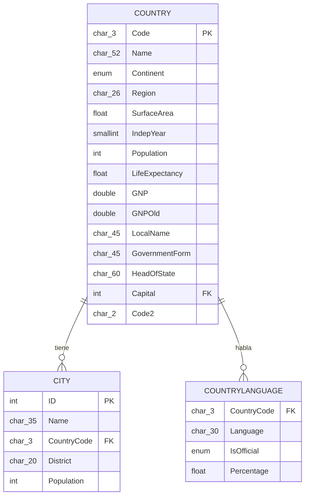

# Base de datos World

Se utiliza el dump oficial de MySQL para ejemplos
(`world-db.tar.gz`, <https://dev.mysql.com/doc/index-other.html>), guardado en
`database/world.sql`. Contiene tres tablas: `country`, `city` y
`countrylanguage`.

## Diagrama entidad-relación



## Tablas usadas por la aplicación

### `country`

- Clave primaria: `Code` (código ISO de 3 letras, por ejemplo `COL`, `USA`).
- La aplicación solo lee `Code` y `Name` para llenar el selector.

### `city`

- Clave primaria: `ID`.
- Clave foránea: `CountryCode` → `country.Code`.
- La aplicación lee `Name`, `District` y `Population`.

## Consultas utilizadas

**1. Listar los países del selector**

```sql
SELECT Code, Name
FROM country
ORDER BY Name;
```

**2. Obtener todas las ciudades de un país (ordenadas por población)**

```sql
SELECT ID, Name, District, Population
FROM city
WHERE CountryCode = :code
ORDER BY Population DESC, Name ASC;
```

**3. Top 10 de ciudades más pobladas de un país**

```sql
SELECT Name, District, Population
FROM city
WHERE CountryCode = :code
ORDER BY Population DESC
LIMIT 10;
```

**4. Bottom 10 de ciudades menos pobladas de un país**

```sql
SELECT Name, District, Population
FROM city
WHERE CountryCode = :code
ORDER BY Population ASC
LIMIT 10;
```

> En la implementación, el controlador `CityController` obtiene todas las
> ciudades en una sola consulta y deriva el `top10` y el `bottom10` a partir de
> la colección, evitando tres viajes a la base de datos.

## Importación automática en Docker

El archivo `database/world.sql` se monta como
`/docker-entrypoint-initdb.d/world.sql` en el contenedor `mysql:8.0`. Cuando el
volumen `db_data` está vacío, el entrypoint oficial de MySQL ejecuta el dump
antes de aceptar conexiones de la aplicación. El dump contiene su propio
`CREATE DATABASE world` y `USE world`.

Para volver a importar desde cero: `docker compose down -v`.
